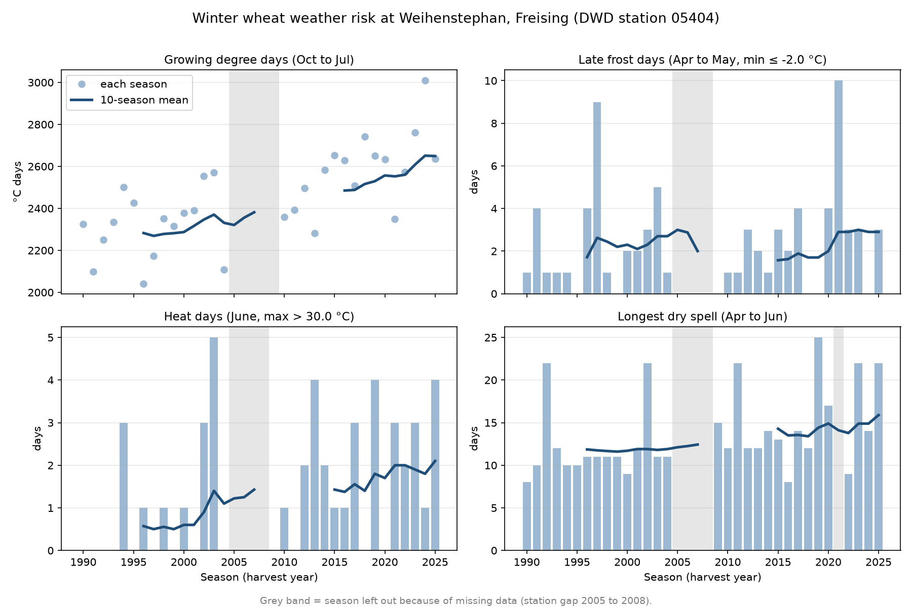

# Freising Crop-Season Weather Toolkit

**Question:** How have frost, heat and drought risk for winter wheat in Freising changed since 1990?

**Who cares:** Wheat farmers and advisers around Freising deciding on sowing dates, variety choice and irrigation, and anyone asking how climate change is already showing up in Bavarian fields.

## Result



Between 1991–2000 and 2016–2025, the winter wheat season at Weihenstephan became about 16% warmer, June days above 30 °C rose from 0.6 to 2.1 per season, and the longest April to June dry spell grew from 11.7 to 15.9 days. Late frost days did not fall (2.3 vs 2.9, driven mostly by the cold April of 2021), and because the crop now reaches its frost-sensitive stages earlier, each spring frost may do more harm.

| Indicator (season average)                | 1991–2000 | 2016–2025 | Change                               |
| :---------------------------------------- | :-------: | :-------: | :----------------------------------- |
| Growing degree days, Oct to Jul (°C days) |   2287    |   2649    | +362 (+16%)                          |
| Late frost days, Apr to May (min ≤ −2 °C) |    2.3    |    2.9    | +0.6 (≈ flat without 2021)           |
| Heat days, June (max > 30 °C)             |    0.6    |    2.1    | +1.5 days                            |
| Longest dry spell, Apr to Jun (days)      |   11.7    |   15.9    | +4.2 days (9 seasons in late decade) |

Full numbers: `results/decade_comparison.csv` and `results/season_indicators.csv`.

## Data

- **Source:** Deutscher Wetterdienst (DWD), Climate Data Center, daily climate observations (KL), station 05404 Weihenstephan-Dürnast, Freising.
- **Licence:** Open data under the DWD terms of use (CC BY 4.0). Source: Deutscher Wetterdienst.
- **Downloaded:** 2026-11-12 with `python src/get_data.py`. The raw data is not stored in this repository; the script fetches it.

## Method

1. Download the station's daily record from DWD and clean it: readable column names, missing values (`−999`) turned into empty cells (`src/get_data.py`).
2. Split the record into wheat seasons named by harvest year: season 2024 runs from 1 Oct 2023 to 31 Jul 2024.
3. Calculate four indicators per season (`src/indicators.py`, thresholds in `src/config.py`): growing degree days above 0 °C; late frost days in April and May with a minimum at or below −2 °C; June heat days above 30 °C; the longest run of days under 1 mm of rain from April to June.
4. Leave a season out of an indicator if any day in its window is missing, so a gap never looks like "no frost" or "no rain".
5. Plot every season with a 10-season rolling mean, and compare the averages of 1991–2000 and 2016–2025 (`src/analyse.py`).

## Limitations

- **Calendar, not crop stage.** The windows are fixed dates. In warmer years the crop reaches stem elongation and flowering earlier, which these indicators can't see.
- **Station gap.** DWD has no data for this station from 1 Jan 2005 to 7 Nov 2008, so seasons 2005 to 2008 are missing.
- **One station.** Weihenstephan stands for the Freising area, not for every field in it.
- **Ten seasons are few.** One extreme year moves a decade average a lot (2021 for frost). The changes are described, not tested for statistical significance.
- **Weather risk is not yield.** This shows how often stressful weather happened, not how much yield it cost.

## How to reproduce it

After making and activating a virtual environment (`python -m venv .venv`, then `.venv\Scripts\activate` on Windows):

```bash
pip install -r requirements.txt
python src/get_data.py
python src/analyse.py
```
