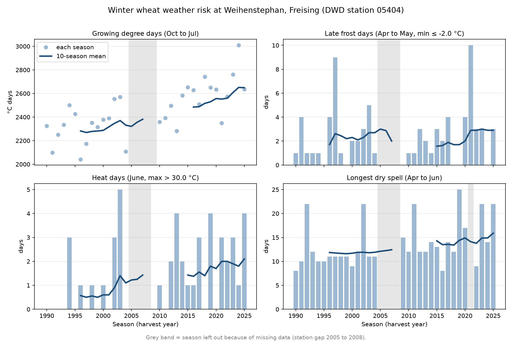

# Frost, Heat and Drought Risk for Winter Wheat in Freising (1990 to 2025)

**Author:** Fabian  
**Version:** 0.1 (November 2026)  
**Code and Data:** [github.com/agtechfabian/freising-crop-weather](https://github.com/agtechfabian/freising-crop-weather)

---

## Summary

Between 1991–2000 and 2016–2025, the growing season for winter wheat at Weihenstephan became about **16% warmer**, and heat and drought stress rose clearly.

- **Heat:** June days above 30 °C went from 0.6 to 2.1 per season, adding about one and a half extra hot days around flowering.
- **Drought:** The longest dry spell between April and June grew by about four days, moving from 11.7 to 15.9 days.
- **Frost:** Late frost days did not fall (2.3 vs 2.9, a change driven mostly by the cold April of 2021). Because warmer winters push the crop to its frost-sensitive stages earlier, each spring frost may now do more harm.

_Key Limitation:_ The indicators use fixed calendar windows rather than the crop's actual growth stages, and the station lacks records from 2005 to 2008.

---

## 1. Question

Three kinds of weather hurt winter wheat most: **frost after stem elongation**, **heat at flowering**, and **spring dry spells**. This report addresses the question: _How have frost, heat and drought risk for winter wheat in Freising changed since 1990?_ The answers are vital for farmers making decisions on sowing dates, variety selection, and irrigation management.

---

## 2. Data

Daily climate observations were sourced from the German Weather Service (DWD), station **05404 Weihenstephan-Dürnast**. The data is open under the CC BY 4.0 licence (source: Deutscher Wetterdienst) and was downloaded on 12 November 2026.

> **Note on Data Gap:** The station has no records from 1 January 2005 to 7 November 2008, meaning seasons 2005 through 2008 are omitted from the analysis.

---

## 3. Method

An agricultural season is named by its harvest year and runs from **1 October to 31 July**. For each season from 1990 to 2025, four key indicators were calculated:

| Indicator               | Window          | Rule                            | Why                        |
| :---------------------- | :-------------- | :------------------------------ | :------------------------- |
| **Growing degree days** | 1 Oct to 31 Jul | Sum of daily mean above 0 °C    | Overall warmth             |
| **Late frost days**     | 1 Apr to 31 May | Daily minimum ≤ −2 °C           | Damages the exposed ear    |
| **Heat days**           | 1 to 30 Jun     | Daily maximum > 30 °C           | Pollen fails, fewer grains |
| **Longest dry spell**   | 1 Apr to 30 Jun | Longest run of days < 1 mm rain | Peak water use             |

- **Data Integrity:** A season was left out of an indicator if any day in its window was missing, ensuring a data gap never looks like "no frost" or "no rain".
- **Analysis:** Each indicator was plotted alongside a 10-season rolling mean, comparing the decade averages of 1991–2000 and 2016–2025. The underlying logic is validated by seven automated `pytest` functions.

---

## 4. Results

| Season average                      | 1991–2000 | 2016–2025 | Change                    |
| :---------------------------------- | :-------: | :-------: | :------------------------ |
| **Growing degree days** (°C days)   |   2287    |   2649    | +362 (+16%)               |
| **Late frost days**                 |    2.3    |    2.9    | +0.6 (≈ 2.1 without 2021) |
| **June heat days**                  |    0.6    |    2.1    | +1.5 days                 |
| **Longest spring dry spell** (days) |   11.7    |   15.9    | +4.2 days (9 seasons)     |

- **Warmth:** Nine of the last ten seasons recorded more than 2,500 °C days—a threshold reached only once during the 1990s (in 1994). Season 2024 was the warmest on record at 3,011 °C days.
- **Heat:** In the 1990s, six out of ten Junes experienced no days above 30 °C. In contrast, during 2016–2025, only two Junes had zero heat days. While the relative increase is +250%, absolute days (+1.5 days per season) provide a more honest measure due to the small starting baseline.
- **Drought:** Spring dry spells lasting three weeks or more occurred only once in the 1990s (1992). In the past decade, they happened three times (2019, 2023, and 2025), with 2019 holding the record at 25 consecutive dry days.

---

## 5. What It Means for a Farmer

Heat and drought around flowering are no longer rare occurrences in Freising. Consequently, **heat-tolerant, earlier-flowering crop varieties** and **water-saving soil management practices** warrant serious attention. Furthermore, late frost risk has not disappeared; because warmer winters cause crops to develop earlier, identical spring frost events now encounter plants at more vulnerable growth stages.

---

## 6. Limitations and Next Steps

- **Fixed Calendar Windows:** The model ignores actual crop growth stages.
- **Station Limits:** Analysis relies on a single station with a missing data gap from 2005 to 2008.
- **Statistical Scope:** Ten-season averages fluctuate significantly with a single extreme year, and no formal significance testing was performed.
- **Weather vs. Yield:** Indicators measure stressful weather events rather than direct crop yield losses.

**Version 1.0 Roadmap:** Add a second DWD station for comparative analysis and package the logic into a command-line tool capable of processing any station. Future iterations may replace fixed dates with modelled growth stages.
